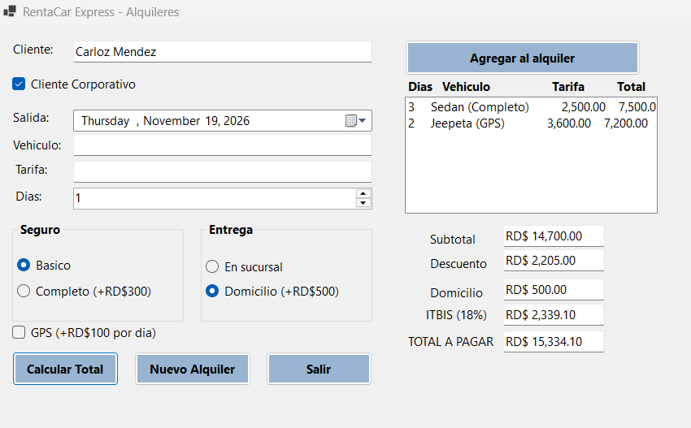
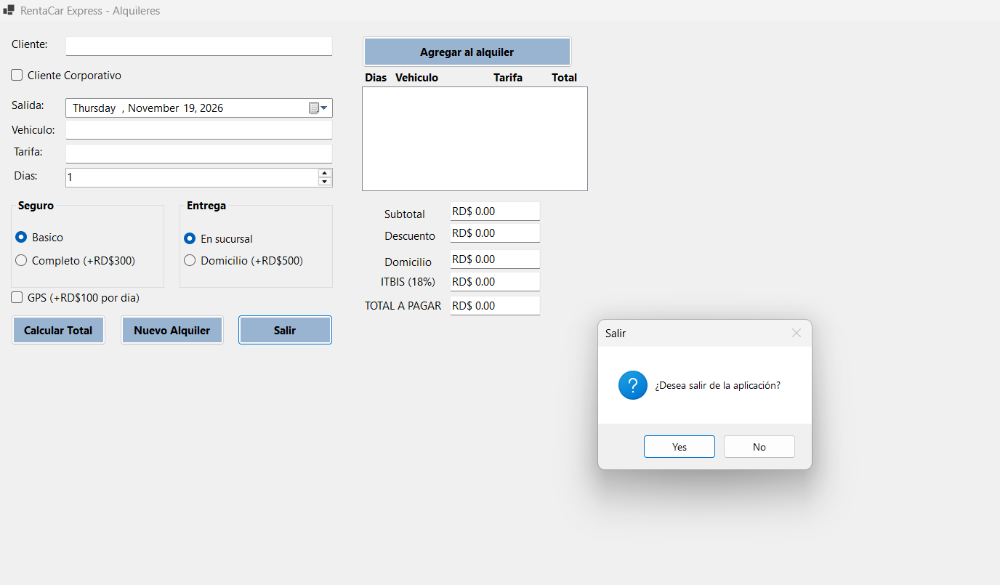

# Sistema de Alquiler de Vehículos - RentaCar

## Información del autor
- Nombre: Astrid Carolina De La Cruz De La Cruz
- Matrícula: 2026-1718
- Asignatura: Programación Básica
- Lenguaje: C#
- Tecnología: Windows Forms

## Descripción del proyecto
Este proyecto consiste en desarrollar una aplicación de escritorio utilizando C# y Windows Forms para gestionar el alquiler de vehículos.

El sistema permite registrar vehículos, seleccionar servicios adicionales, calcular los costos del alquiler y mostrar un resumen con los valores correspondientes.

## Datos de entrada
El programa solicita los siguientes datos:
- Nombre del cliente.
- Vehículo seleccionado.
- Tarifa diaria.
- Cantidad de días de alquiler.
- Tipo de seguro: básico o completo.
- Servicio adicional de GPS.
- Tipo de cliente: corporativo o regular.
- Modalidad de entrega: en sucursal o a domicilio.
- Fecha de salida.

## Procesamiento
El sistema realiza los siguientes cálculos y operaciones:

- Calcula el costo del alquiler multiplicando la tarifa diaria por la cantidad de días.
- Aplica un recargo de RD$300 por el seguro completo.
- Aplica un recargo de RD$100 por el servicio de GPS.
- Calcula un descuento del 15% para clientes corporativos.
- Agrega RD$500 por el servicio a domicilio.
- Calcula el ITBIS del 18%.
- Calcula el subtotal y el total final del alquiler.

## Datos de salida
La aplicación muestra:
- Lista de vehículos agregados al alquiler.
- Días de alquiler.
- Descripción del vehículo y servicios seleccionados.
- Tarifa diaria con recargos.
- Total por cada vehículo.
- Subtotal.
- Descuento aplicado.
- Costo de domicilio.
- ITBIS.
- Total final a pagar.

## Validaciones
El sistema incluye las siguientes validaciones:
- El nombre del cliente no puede estar vacío.
- El vehículo no puede estar vacío.
- La tarifa debe ser un número decimal válido y mayor que cero.
- No se permite calcular el total sin agregar al menos un vehículo.
- Se muestra una confirmación antes de salir de la aplicación.

## Funcionalidades adicionales
- Botón para agregar vehículos al alquiler.
- Botón para calcular el total.
- Botón para limpiar todos los campos.
- Botón para salir de la aplicación.
- Reinicio de los campos del vehículo después de agregarlo.
- Formato monetario en pesos dominicanos (RD$).

## Constantes utilizadas
- Seguro completo: RD$300.
- GPS: RD$100.
- Descuento corporativo: 15%.
- Servicio a domicilio: RD$500.
- ITBIS: 18%.

## Capturas de pantalla

### Datos del alquiler

### Nuevo alquiler

### Salir del sistema

